# PlastiPack | Proyecto final AI-901

## Plataforma web empresarial para la gestión y comercialización de bolsas con asistente inteligente

<table>
  <tbody>
    <tr><th scope="row">Alumno</th><td>Edgar Vladimir Rocha Solís</td></tr>
    <tr><th scope="row">Materia</th><td>Fundamentos de IA con tecnologías Microsoft</td></tr>
    <tr><th scope="row">Proyecto</th><td>Proyecto Fase 2</td></tr>
    <tr><th scope="row">Fecha de entrega</th><td>6 de noviembre de 2026</td></tr>
  </tbody>
</table>

**Enlace del prototipo publicado en Azure:**  
https://plastipack-mc-694534.azurewebsites.net

## Tabla de contenido

- [1. Descripción general](#1-descripción-general)
- [2. Problema identificado](#2-problema-identificado)
- [3. Objetivo](#3-objetivo)
- [4. Alcance de la solución](#4-alcance-de-la-solución)
- [5. Arquitectura](#5-arquitectura)
- [6. Tecnologías utilizadas](#6-tecnologías-utilizadas)
- [7. Funcionalidades implementadas](#7-funcionalidades-implementadas)
- [8. Evidencias](#8-evidencias)
- [9. Casos de prueba](#9-casos-de-prueba)
- [10. Limitaciones del prototipo](#10-limitaciones-del-prototipo)
- [11. Resultados obtenidos](#11-resultados-obtenidos)
- [12. Conclusión](#12-conclusión)

## 1. Descripción general

PlastiPack es una plataforma web empresarial para presentar y consultar el catálogo de bolsas de la empresa. Reúne en un mismo sitio información sobre la marca y sus productos, herramientas para explorar el catálogo y una experiencia de compra demostrativa.

La plataforma incluye BolsaBot, un asistente que orienta a los clientes con información del catálogo, y un área de Administración para consultar indicadores de ventas, clientes, productos e inventario. Los pedidos se registran únicamente como pruebas con cuentas demo y datos ficticios; no se procesan pagos reales.

El sitio se desarrolló con React y Vite, utiliza Supabase para guardar los pedidos de prueba, Microsoft Foundry para el asistente inteligente y está desplegado en Microsoft Azure.

## 2. Problema identificado

Los clientes que buscan bolsas para empaque, almacenamiento y distribución necesitan conocer las opciones disponibles y comparar sus características para elegir un producto adecuado. Si la información del catálogo no está presentada de forma clara y centralizada, encontrar y evaluar esas opciones puede resultar difícil y requerir asistencia manual.

PlastiPack también necesita una forma organizada de presentar sus productos y mostrar información útil para la gestión del negocio. Por ello, el problema que aborda este proyecto es la falta de una experiencia digital integrada que reúna la consulta del catálogo, la orientación al cliente y la visualización de indicadores operativos.

## 3. Objetivo

Desarrollar una plataforma web para PlastiPack que integre la presentación de la empresa, la consulta de su catálogo y la simulación del proceso de compra, con el fin de ofrecer una experiencia clara a los clientes y demostrar el uso de inteligencia artificial y herramientas de análisis empresarial.

Para cumplir este objetivo, la solución permite:

- Explorar los productos disponibles en el catálogo.
- Recibir orientación de compra mediante BolsaBot, con información del catálogo.
- Registrar pedidos de prueba con datos ficticios.
- Consultar indicadores operativos desde el área de Administración.

## 4. Alcance de la solución

La solución se organiza en tres áreas, cada una enfocada en una parte de la experiencia:

| Área | Propósito | Funcionalidades incluidas |
|---|---|---|
| **Sitio corporativo** | Presentar PlastiPack y orientar al visitante. | Presentación de la empresa, casos de uso de los productos y accesos a la tienda y a BolsaBot. |
| **Tienda digital** | Facilitar la consulta del catálogo y simular una compra. | Catálogo de 20 productos, búsqueda y filtros por categoría y tamaño, carrito, simulación de pedido y perfil demostrativo. |
| **Administración** | Consultar información operativa del negocio. | Resumen ejecutivo, ventas por periodo, clasificación de productos, indicadores de clientes, gestión de inventario y acceso por roles. |

## 5. Arquitectura

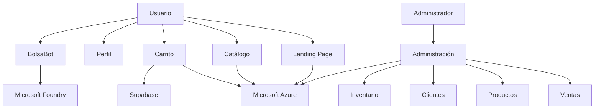

### Componentes

<table border="1" style="border-collapse: collapse;">
  <tr><th style="border: 1px solid;">Componente</th><th style="border: 1px solid;">Descripción</th></tr>
  <tr><td style="border: 1px solid;">React</td><td style="border: 1px solid;">Biblioteca utilizada para construir la interfaz.</td></tr>
  <tr><td style="border: 1px solid;">Vite</td><td style="border: 1px solid;">Herramienta de desarrollo y compilación.</td></tr>
  <tr><td style="border: 1px solid;">Microsoft Azure</td><td style="border: 1px solid;">Plataforma de despliegue y hospedaje.</td></tr>
  <tr><td style="border: 1px solid;">Supabase</td><td style="border: 1px solid;">Servicio utilizado para registrar pedidos de prueba con cuentas demo y datos ficticios.</td></tr>
  <tr><td style="border: 1px solid;">Microsoft Foundry</td><td style="border: 1px solid;">Servicio utilizado para el asistente inteligente.</td></tr>
  <tr><td style="border: 1px solid;">BolsaBot</td><td style="border: 1px solid;">Asistente virtual del catálogo.</td></tr>
  <tr><td style="border: 1px solid;">Administración</td><td style="border: 1px solid;">Área de análisis empresarial con indicadores de ventas, productos, clientes e inventario.</td></tr>
</table>

## 6. Tecnologías utilizadas

- React
- Vite
- JavaScript
- HTML5
- CSS3
- Microsoft Azure
- Supabase
- Microsoft Foundry
- Git
- GitHub

## 7. Funcionalidades implementadas

<table border="1" style="border-collapse: collapse;">
  <tr><th style="border: 1px solid;">Área</th><th style="border: 1px solid;">Funcionalidades</th></tr>
  <tr><td style="border: 1px solid;"><strong>Página corporativa</strong></td><td style="border: 1px solid;">Presentación de la marca, mensajes promocionales, casos de uso y accesos a la tienda y al asistente virtual.</td></tr>
  <tr><td style="border: 1px solid;"><strong>Catálogo</strong></td><td style="border: 1px solid;">20 productos con imágenes, categorías y especificaciones; búsqueda dinámica y filtros.</td></tr>
  <tr><td style="border: 1px solid;"><strong>Carrito</strong></td><td style="border: 1px solid;">Agregar y eliminar productos, ajustar cantidades y calcular importes automáticamente.</td></tr>
  <tr><td style="border: 1px solid;"><strong>Flujo de compra</strong></td><td style="border: 1px solid;">Selección de entrega o recolección, captura de datos ficticios, resumen y registro del pedido de prueba en Supabase.</td></tr>
  <tr><td style="border: 1px solid;"><strong>Perfil de usuario</strong></td><td style="border: 1px solid;">Datos demostrativos, dirección de ejemplo e historial ficticio de pedidos.</td></tr>
  <tr><td style="border: 1px solid;"><strong>Administración</strong></td><td style="border: 1px solid;">Resumen e indicadores operativos de ventas, productos, clientes e inventario.</td></tr>
  <tr><td style="border: 1px solid;"><strong>Inteligencia artificial</strong></td><td style="border: 1px solid;">BolsaBot recomienda productos, orienta la compra y responde con base en el catálogo.</td></tr>
</table>

## 8. Evidencias

### Evidencia 1. Página corporativa

Presenta la marca PlastiPack y ofrece acceso a las principales secciones de la plataforma.

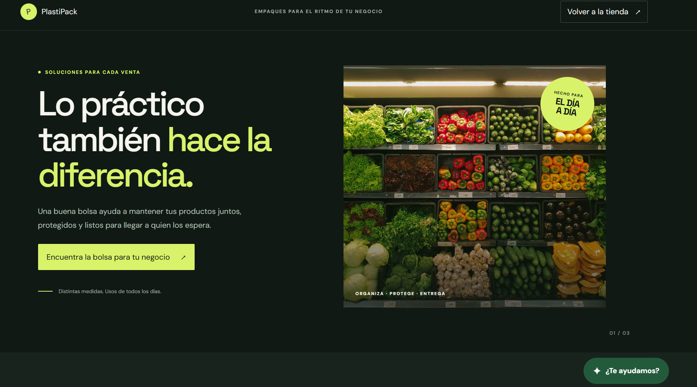

### Evidencia 2. Casos de uso de productos

Muestra ejemplos de las necesidades y actividades para las que se pueden utilizar los productos.

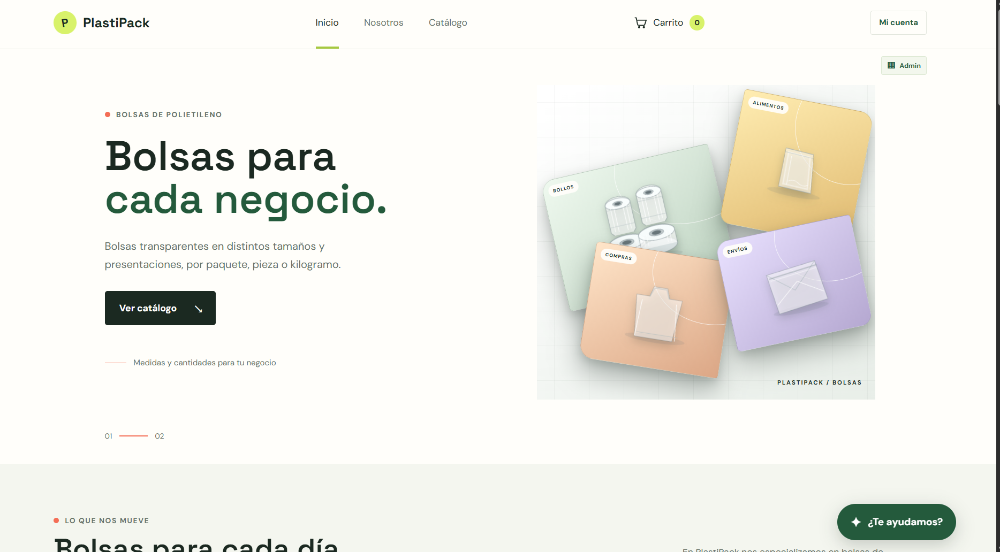

### Evidencia 3. Catálogo de productos

Permite consultar los productos disponibles y revisar sus características.

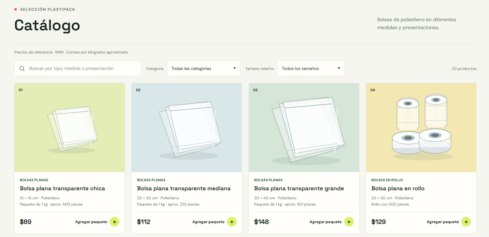

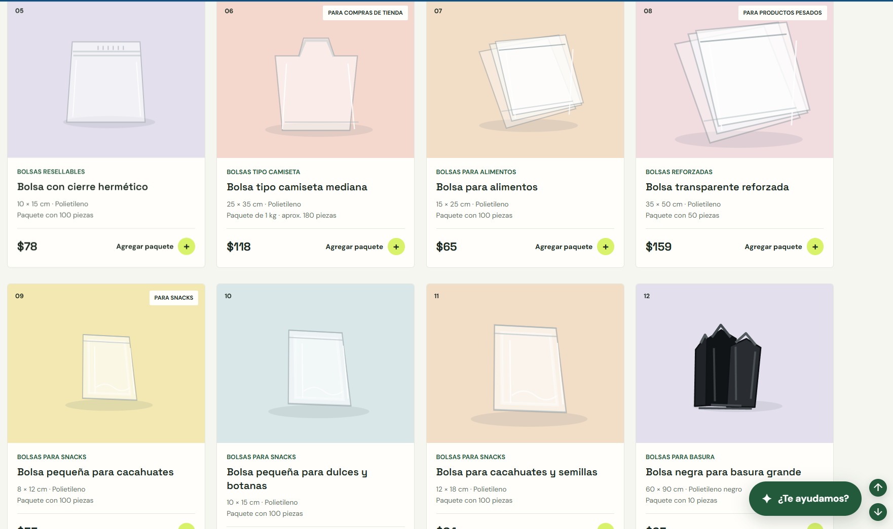

### Evidencia 4. Carrito de compras y métodos de entrega

Ilustra la revisión de los productos seleccionados y la elección entre entrega a domicilio o recolección.

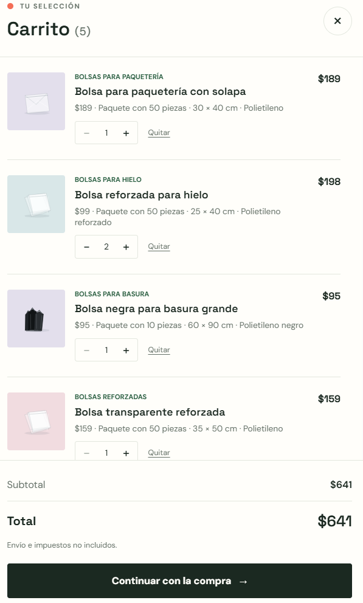 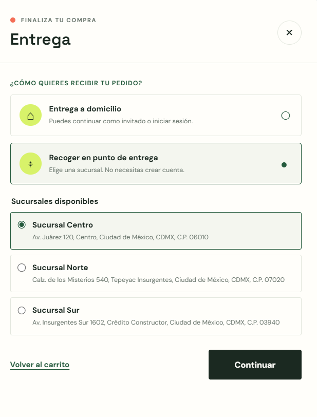

### Evidencia 5. Resumen del pedido y confirmación de compra

Muestra la verificación de los datos del pedido de prueba y su confirmación.

 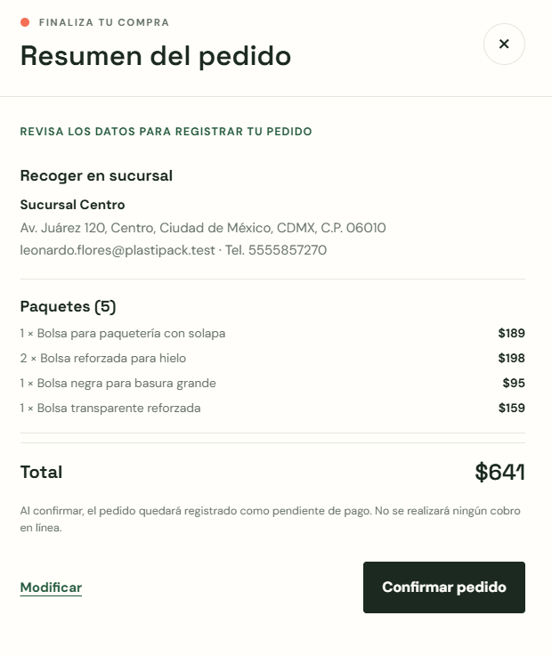

### Evidencia 6. Perfil de usuario

Presenta información demostrativa del usuario y un historial simulado de pedidos.

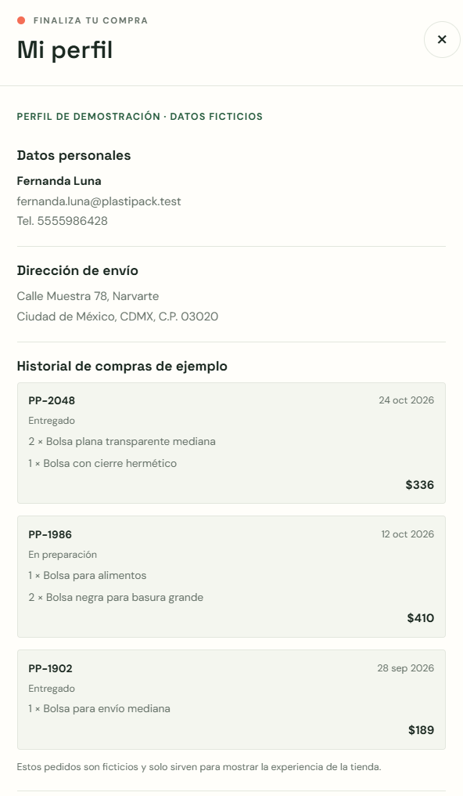

### Evidencia 7. Acceso a Administración

Muestra las opciones de acceso como invitado o administrador.

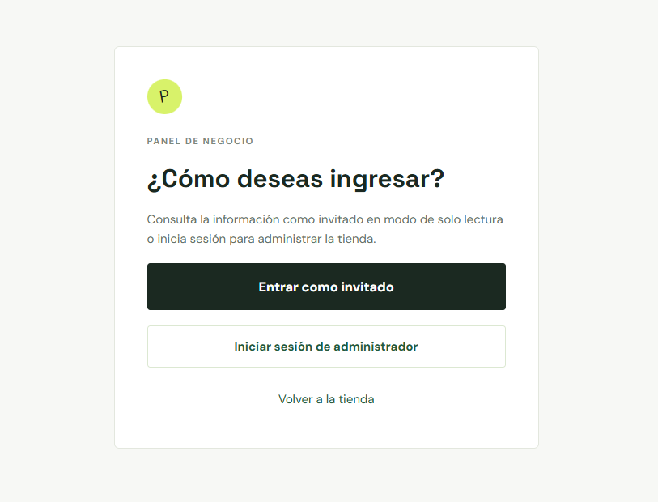

### Evidencia 8. Resumen general

Resume indicadores del negocio, como pedidos, clientes e importes registrados.

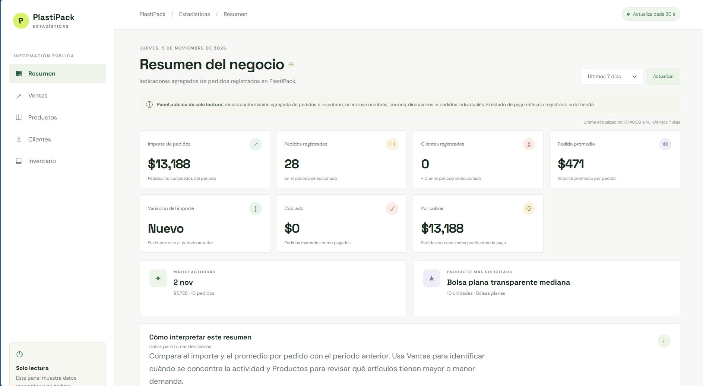

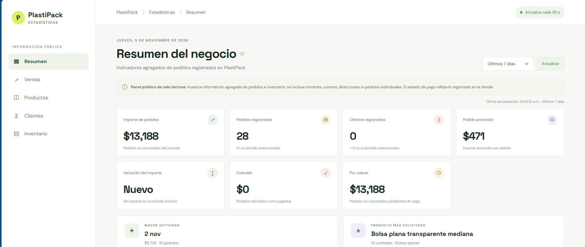

### Evidencia 9. Módulo de ventas

Presenta estadísticas y tendencias de ventas para el periodo consultado.

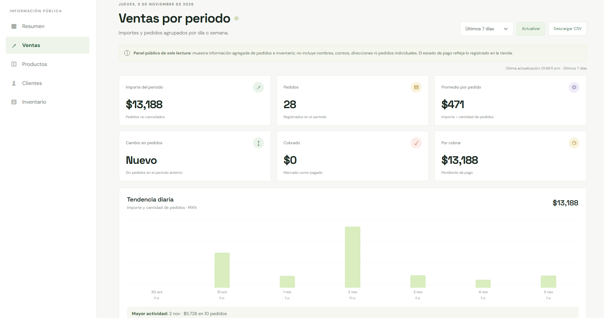

### Evidencia 10. Productos solicitados

Muestra la clasificación de los productos y su nivel de demanda.

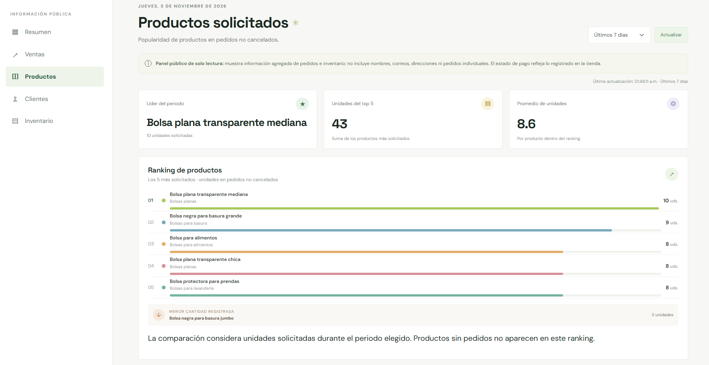

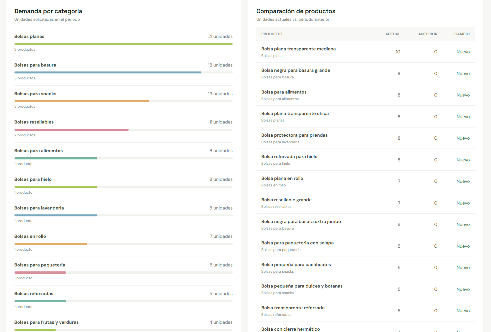

### Evidencia 11. Indicadores de clientes

Presenta métricas agregadas relacionadas con los clientes registrados.

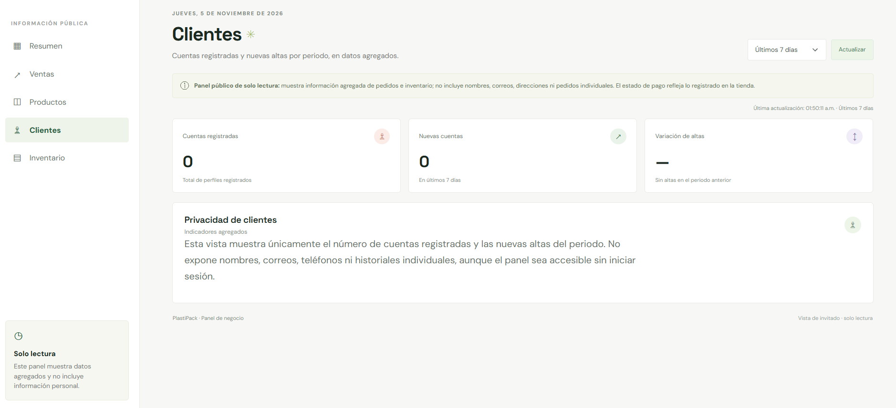

### Evidencia 12. Inventario

Permite revisar las existencias disponibles y detectar productos que requieren reabastecimiento.

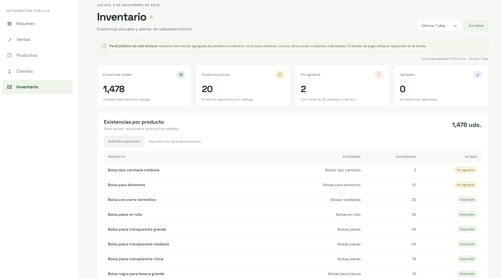

### Evidencia 13. BolsaBot

Asiste al usuario con recomendaciones y respuestas basadas en la información del catálogo.

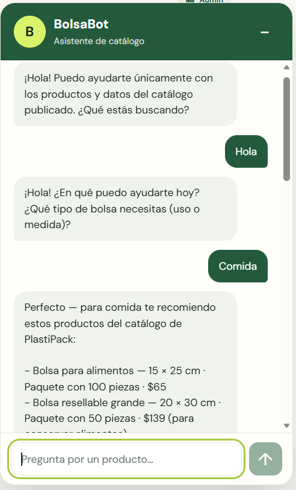

## 9. Casos de prueba

| ID | Componente | Acción | Resultado esperado | Resultado obtenido | Estado |
|---|---|---|---|---|---|
| P01 | Catálogo | Consultar productos | Mostrar los productos registrados | Correcto | ✅ |
| P02 | Búsqueda | Buscar un producto | Filtrar coincidencias | Correcto | ✅ |
| P03 | Filtros | Aplicar una categoría | Mostrar resultados filtrados | Correcto | ✅ |
| P04 | Carrito | Agregar un producto | Actualizar el carrito | Correcto | ✅ |
| P05 | Carrito | Modificar la cantidad | Actualizar el total | Correcto | ✅ |
| P06 | Carrito | Eliminar un producto | Actualizar el total | Correcto | ✅ |
| P07 | Entrega | Seleccionar una modalidad | Registrar la selección | Correcto | ✅ |
| P08 | Datos | Completar el formulario | Permitir continuar el flujo | Correcto | ✅ |
| P09 | Pedido | Confirmar el pedido | Guardar el pedido de prueba en Supabase | Correcto | ✅ |
| P10 | Administración | Consultar indicadores | Mostrar estadísticas | Correcto | ✅ |
| P11 | Inventario | Revisar existencias | Mostrar el inventario disponible | Correcto | ✅ |
| P12 | BolsaBot | Solicitar una recomendación | Recomendar productos | Correcto | ✅ |

## 10. Limitaciones del prototipo
 
La solución se desarrolló con fines académicos.

Actualmente:

- No procesa pagos reales.
- Registra pedidos de prueba en Supabase al utilizar cuentas demo y datos ficticios; no registra compras reales.
- No utiliza información personal real.
- Utiliza datos de demostración.
- Los historiales son simulados.
- No cuenta con autenticación productiva.

### Privacidad y seguridad

- Los datos mostrados en los perfiles son ficticios.
- Los historiales son demostrativos.
- No se exponen datos personales reales.
- El prototipo presenta opciones diferenciadas para administrador e invitado; el acceso de invitado es de solo lectura.

### Transparencia

BolsaBot informa que sus respuestas se basan únicamente en la información del catálogo publicado.

### Rendición de cuentas

Las consultas que estén fuera del alcance de la información disponible deben escalarse a personal autorizado.

## 11. Resultados obtenidos

Se implementó y publicó una plataforma web que reúne la presencia corporativa de PlastiPack y las principales funciones del prototipo:

- Catálogo de 20 productos con búsqueda y filtros.
- Flujo de compra demostrativo; los pedidos de prueba se guardan en Supabase con datos ficticios y no se procesan pagos.
- BolsaBot, asistente que orienta a los clientes con información del catálogo.
- Área de Administración con indicadores de ventas, productos, clientes e inventario.

La aplicación se desarrolló con React y Vite, integra Microsoft Foundry para el asistente y está desplegada en Microsoft Azure. Las pruebas documentadas confirman el funcionamiento de los flujos principales del prototipo.

## 12. Conclusión

PlastiPack demuestra cómo una plataforma web moderna puede combinar presencia corporativa, comercio digital, analítica empresarial e inteligencia artificial en una misma solución.

El proyecto permitió aplicar conceptos de desarrollo web, despliegue en Microsoft Azure, diseño de experiencia de usuario e integración de asistentes inteligentes mediante Microsoft Foundry. La solución cumple los objetivos definidos para el proyecto AI-901 y proporciona una base para futuras ampliaciones y escenarios reales de negocio.